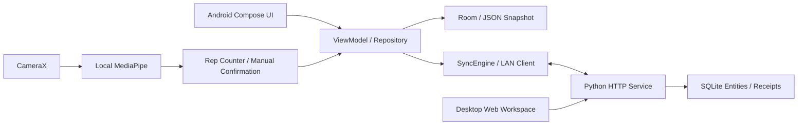

# 架构与源码导航

## 运行关系

## 主要文件

所有Android源码路径均相对于`android/app/src/main/java/com/trytobatter/app/`。

| 文件/目录 | 职责 |
| --- | --- |
| `BatterApp.kt` | 五主导航、事项编辑、结果订正、训练、更新及复盘路由 |
| `BatterViewModel.kt` | Repository状态与操作结果消息 |
| `core/model/Models.kt` | TaskItem、ExecutionRecord、WorkoutRecord、AppSnapshot及基础执行规则 |
| `core/data/AppRepository.kt` | 本地保存、业务变更、同步与操作编排 |
| `core/data/SnapshotCodec.kt` | JSON快照编解码与字段验证 |
| `core/data/SyncEngine.kt` | 变更排队、远端合并、冲突与回执 |
| `core/data/LanClient.kt`、`LanDiscovery.kt` | HTTP与局域网发现 |
| `core/data/CredentialStore.kt` | 设备配对凭证单独保存 |
| `core/model/RepeatRules.kt` | 按天/周、截止日期、实例生成与系列修改范围 |
| `core/model/PeriodReview.kt` | 按日期窗口汇总计划和结果、Markdown输出 |
| `feature/records/PeriodReviewScreen.kt` | 周报/14天复盘与系统文件导出 |
| `feature/petpreview/` | 独立Compose桌宠预览、帧动画与本地模拟窗口；不引用Repository/Room/同步 |
| `core/model/UnifiedTraining.kt`、`UnifiedWorkoutDraft.kt` | 七动作模板、实际组次与可恢复草稿 |
| `feature/workout/` | 跟练、相机预览、本机姿态与有限动作计数 |
| `core/alarm/` | App本地提醒、系统时钟交接与状态展示 |
| `core/designsystem/` | 当前主题、五主页面共用组件及展示规则 |

电脑端的`server/server.py`提供配对、计划发布、版本检查、资源打开和同步；`server/web/`为本机管理与学习工作台；测试使用隔离数据库。

## 数据与同步原则

AppSnapshot现有字段承载事项、执行记录、训练、待发操作、远端快照和冲突。手机先保存，再发送；收到对应操作回执后才清除待发项。状态变化使用版本校验，已开始的执行快照和历史受保护。

新重复规则沿用`repeatRule`字符串：`R1|D或W|间隔|星期列表|截止日期`。截止日期内完整生成实例，普通编辑不会后台重建已删除实例；明确修改规则时，确认范围后重建后续可修改实例。

复盘是只读汇总。计划按安排日期，执行/训练按结束日期；关联事项的结果可能跨周期，界面和导出说明口径。未知数据保留未知，模拟数据排除，训练计时单列。

## 分享版边界

Android生产源码与模型文件按快照复制；Windows启动脚本改为从PATH寻找Python。真实运行库、菜单、日程、诊断、发布渠道数据和本机配置保留在原环境。菜谱目录在本快照是明确标识的占位入口。

[源码复制清单](SOURCE_SNAPSHOT.json)记录复制文件的哈希和启动脚本的便携化改动。
