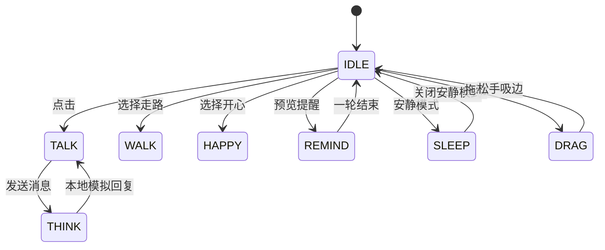
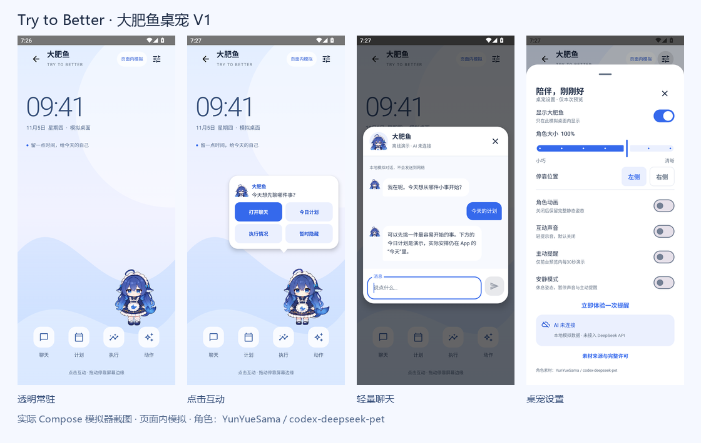

# Try to Better · Android 大肥鱼桌宠 V1

## 范围与基线

基于目标仓库 main `91949f3b190f6293e832698cd2681afd66e12c31`（0.2.19 / code21）检查后设计。工程为单 app Gradle 模块，Kotlin / Compose / Material 3，五主页面由 `BatterApp.kt` 导航，Room 保存 JSON 快照，电脑同步独立。此功能仅新增 `feature/petpreview/`、本地素材、我的页入口与二级路由。业务模型、数据库、同步、训练、提醒保持原实现。

本阶段是**应用页面内的模拟桌面**。从“我的 → 大肥鱼桌宠预览”进入；退出页面后角色消失。没有系统悬浮窗、悬浮窗权限、后台服务或 DeepSeek API。聊天、今日计划和执行情况均为标记清楚的本地示例，不写入真实事项。

## 视觉与交互决策

- 背景采用蓝白、淡紫渐变及柔和弧线。桌面时钟为固定示意时间，顶部始终显示“页面内模拟”。背景不依赖第三方壁纸。
- 主角直接使用透明 RGBA 完整帧，默认右侧、屏幕下半部停靠；不放在卡片、白底或圆形容器中。角色方形画布完整等比显示，头发、鳍、裙摆、鞋与尾巴均保留。
- 大小 112–208dp，默认 176dp；触摸目标至少 48dp。上下为标题及底部快捷入口预留空间，横向离边 8dp。拖动实时限制完整画布，松手吸附最近边缘，保留纵向位置。屏幕或大小改变时重新限制位置。
- 点击只展开约 272dp 宽的小气泡：原角色头像、短句、聊天 / 今日计划 / 执行情况 / 暂时隐藏四个入口。拖动时收起气泡。
- 聊天为蓝白圆角轻窗口，头像、离线状态、关闭、消息、输入、发送、思考状态齐全。空消息不能发送；模拟回复有短暂思考。聊天历史只在预览会话中存在。
- 设置使用可滚动底部窗口。显示、大小、靠边、动画、声音、主动提醒、安静模式均影响原型；AI 状态只展示“未连接 / 本地演示”。署名与完整许可可在设置中打开。
- 声音默认关闭；开启后仅显式互动发出短提示音。主动提醒默认关闭，开启后每 30 秒在前台空闲预览内演示一次，不是系统通知。安静模式抑制两者并让角色休息。
- 底部四个快捷入口均可操作：聊天、计划、执行、动作；临时隐藏后出现“叫她回来”。返回键优先关闭当前窗口或气泡，再退出预览。

## 素材与授权

作者：**YunYueSama**。来源：[codex-deepseek-pet](https://github.com/YunYueSama/codex-deepseek-pet)，固定版本 `7661c8b304c5400701f91da01b1a643a207331de`。

复制前已逐字阅读 [LICENSE](https://github.com/YunYueSama/codex-deepseek-pet/blob/7661c8b304c5400701f91da01b1a643a207331de/LICENSE) 和 [ASSET_LICENSE.md](https://github.com/YunYueSama/codex-deepseek-pet/blob/7661c8b304c5400701f91da01b1a643a207331de/ASSET_LICENSE.md)。这是自定义“大肥鱼项目署名许可 1.0”，不是标准 MIT。作者允许复用、修改、展示和分发其有权授权的贡献，要求保留作者、仓库、完整许可及修改说明；不能暗示作者或 DeepSeek 官方认可。本项目同时保留该授权对第三方权利的限制。

**授权范围仍有边界：**上游素材基于社区角色参考，经 AI 生成、透明化和图集加工；作者的许可不额外授予底层社区作品、角色设计、商标等权利。本原型不能被当成已完成所有商业角色权利清理的证明。授权未确认的 `assets/你这吃白饭的蓝色大肥鱼.png` 及 `design/references/community-*` 原图均不下载、不打包。设计标准图仅用于核对原角色，不作为运行时立绘。

| 已检查文件 | 实测尺寸 / 排列 | 使用决定 |
| --- | --- | --- |
| design/character-standard.png | 1536×1024，RGB | 仅角色对照，不打包 |
| design/character-sheet.png | 1920×1160，RGBA | 仅角色对照，不打包 |
| dense-idle / walk / jump / sleep / eat / dance / sneak / wave.png | 每张 2048×4096，4列×8行，512px，RGBA | 研究全部；仅 wave、dance 的完整动作帧进入包 |
| actions / expressions.png | 2048×2048，4×4，512px，RGBA | 已研究，不打包 |
| idle-front.png | 2048×1024，2×1，1024px，RGBA | 高清正面待机及闭眼帧 |
| inbetween-walk.png | 2048×2048，4×4，512px，RGBA | 16帧真实步态 |
| inbetween-jump / sleep.png | 每张 2048×6144，4×12，512px，RGBA | 提醒、拖动、睡眠 |
| story-token.png | 1536×3072，4×8，384px，RGBA | 思考完整帧0–2 |
| portrait.png | 1024×1024，RGBA | 聊天 / 气泡原有头像 |

所有运行时单帧均检查 alpha 及四边非透明像素，源图没有接触单元边缘的身体部分。上游 manifest 的部分动作数值与实际 dense 图集不一致，采用实测网格和 `src/renderer/motion.js` 的播放顺序，不按文件名猜帧数。

处理仅为：选择完整方形帧、统一等比缩小（待机512px、动作384px、头像192px）、按播放顺序重新排列、无损 WebP。主角没有重绘、改色、改变头身比例或拆分脸/肢体拼接；向左行走时整帧镜像与上游一致。聊天和气泡头像仅对现有 portrait 进行头肩取景，桌面角色始终完整显示。具体原文件哈希、所选帧、输出哈希见 `android/app/src/main/assets/petpreview/provenance.json`。可用 `scripts/prepare-pet-assets.py --source-dir <该版本上游目录>` 重建；脚本先对所有输入和许可进行固定版本 Git blob 哈希校验，拒绝不同版本文件。APK 内同目录带原文 LICENSE、ASSET_LICENSE.md、NOTICE.txt，设置中可查看。

## 状态机

| 状态 | 原有素材 / 动作 | 触发与结束 |
| --- | --- | --- |
| IDLE | idle-front 两张完整帧，间隔眨眼 | 默认；一轮约5秒，闭眼约200ms |
| WALK | inbetween-walk 16帧，60ms/帧 | 动作菜单；小范围横向行走，碰边反向 |
| THINK | story-token 0–2帧 | 发送消息后；最后一帧保持直至本地回复 |
| TALK | dense-wave 原有挥手动作 | 点击 / 模拟回复；不宣称口型同步 |
| HAPPY | dense-dance 奇数帧 | 动作菜单；完整舞蹈循环 |
| REMIND | inbetween-jump 原有跳跃与中间帧 | 手动或前台模拟提醒；一轮后回待机 |
| SLEEP | inbetween-sleep 的入睡动作 | 安静模式或动作选择；入睡后保持末帧 |
| DRAG | inbetween-jump 第13帧完整姿态 | 拖动期间保持，松手停靠并回待机 |

优先顺序：拖动 > 聊天思考 > 安静模式 > 当前互动 / 用户选定动作 > 待机。隐藏、离开前台、关闭动画时停止推进动画。背景不执行计时提醒；不通过持续缩放或旋转冒充动作。一次只解码所需图集，按字节限制缓存，避免同时解码上游所有大图。

## 下一阶段：原生悬浮窗方案（未实现）

1. 先确认系统悬浮窗用户体验、目标 Android 版本和商用角色授权，再单独建 `feature/petoverlay/`。保留本预览作为无需权限的演示入口。
2. 用户明确开启后，通过 `Settings.ACTION_MANAGE_OVERLAY_PERMISSION` 申请并复查 [`Settings.canDrawOverlays`](https://developer.android.com/reference/android/provider/Settings#canDrawOverlays(android.content.Context))；被拒绝时保留预览，不循环请求。使用 `WindowManager` / [`TYPE_APPLICATION_OVERLAY`](https://developer.android.com/reference/android/view/WindowManager.LayoutParams#TYPE_APPLICATION_OVERLAY)，透明像素格式，非全屏小窗口，`FLAG_NOT_FOCUSABLE`，窗口外触摸正常。透明像素本身并不等于触摸穿透；角色窗口透明留白的命中范围须单独评估，不使用全屏触摸遮罩。
3. 用独立 Service 管理生命周期；按目标系统与实际合规场景确定前台服务类型、通知、启动限制及后台策略，不能假设普通应用永不被回收。优先从前台、用户显式点击开启；Android 15起，依赖悬浮窗权限这一豁免从后台启动前台服务时，还需要已有可见悬浮窗口，不能只检查权限，见[官方限制](https://developer.android.com/about/versions/15/behavior-changes-15#fgs-overlay)。提供通知内暂停 / 关闭，权限撤销、锁屏、进程重建均清理窗口。避免借用现有闹钟权限或服务。
4. 使用 WindowMetrics、WindowInsets、DisplayCutout 安全区域计算停靠。覆盖手势导航、三键导航、横竖屏、分屏、折叠、键盘、锁屏和厂商省电策略；避免贴住返回手势边缘。拖动仅移动窗口，不改角色外形。
5. 角色窗口与气泡按需分离；聊天优先打开正常 Activity / 局部窗口处理输入法与焦点，关闭恢复非聚焦小宠物。评估 Android 对遮挡触摸与敏感界面的限制，不绕过系统保护。
6. 设置使用独立 DataStore（或独立配置存储），位置存相对比例并重新限制；不修改 Room 快照和同步协议。接入真实计划之前定义只读适配接口，默认无写权限。AI、账号、API 密钥、成本与隐私另行立项。
7. 真机分别测：权限授权/拒绝/撤销、锁屏/解锁、前后台恢复、旋转/键盘、边缘拖动、耗电/内存、关闭后无窗口与声音、现有五页/同步/数据不受影响。

## 交付与验证

版本：**0.2.20 / code22**，包名 `com.trytobatter.app`。安装后从**我的 → 大肥鱼桌宠预览**进入。此包包含原有五主页面，预览为独立二级功能。APK 通过现有本地更新渠道提供；精确哈希、包体积和验证结果见 [build-and-ui.json](verification/build-and-ui.json)。源码与文档位于 `feat/android-whale-pet-preview-v1` 分支。

完整手机尺寸截图与口径见 [SCREENSHOTS.md](SCREENSHOTS.md)，共18张原始截图，覆盖393dp及360dp。总览仅等比排列实际截图，没有重绘界面。

| 检查 | 实际结果 |
| --- | --- |
| assembleDebug / assembleDebugAndroidTest | 通过 |
| PetPreviewRulesTest | 2项通过，尺寸边界与帧时间范围 |
| RepeatRules / PeriodReview / TaskRules / UnifiedTraining | 30项通过 |
| PetPreviewUiTest，393dp及360dp | 每个尺寸2项通过，共4次执行 |
| 素材检查 | 8张运行图集、96个完整帧、8,347,350字节；RGBA、帧边界及输出哈希通过 |
| Lint | 0错误、28条现有警告；新petpreview目录无警告 |
| APK兼容性 | 包名、minSdk26/targetSdk36及上一版签名保持一致，权限未增加 |
| 数据保护 | Room/模型/快照/同步源码及Manifest未修改；预览不引用业务Repository |

界面检查实际操作了：点击四入口、示例计划/执行、发送与模拟思考/回复、空消息禁用、关闭聊天、拖动到两侧及越界限制、顶部气泡下翻、隐藏/恢复、大小、靠边、显示开关、动画停止、声音/主动提醒开关、30秒前台提醒、安静模式抑制提醒、完整许可查看，以及八种状态选择。走路另开动画验证真实移动，再关闭验证停止。静态截图为了稳定姿态关闭了动画，不能用静图单独证明动画自然度。

测试使用专用模拟器和独立ComponentActivity宿主；没有启动业务MainActivity、重置业务数据或接触私人手机。源码同步回原开发目录时仅使用明确文件清单，84个Android main文件与交付副本逐一比对一致，未复制个人运行数据。未跑全量业务UI、训练相机、后端全回归或实体手机验收；上述相关检查不等于这些场景通过。

### 修改文件清单

路径均相对于仓库根目录。

| 文件 | 变更 |
| --- | --- |
| android/app/src/main/java/com/trytobatter/app/feature/petpreview/PetMotion.kt | 八状态、原始动作时序、安全区域规则 |
| android/app/src/main/java/com/trytobatter/app/feature/petpreview/PetArtwork.kt | 完整图集帧渲染、字节缓存、前台动画与原图头像 |
| android/app/src/main/java/com/trytobatter/app/feature/petpreview/PetPreviewScreen.kt | 模拟桌面、透明角色、拖动吸边、气泡、状态和窗口编排 |
| android/app/src/main/java/com/trytobatter/app/feature/petpreview/PetPreviewPanels.kt | 本地聊天、设置、示例计划/执行、完整许可 |
| android/app/src/main/assets/petpreview/ | idle/walk/think/talk/happy/remind/sleep/portrait.webp；LICENSE、ASSET_LICENSE.md、NOTICE.txt、provenance.json |
| android/app/src/main/java/com/trytobatter/app/BatterApp.kt | 新增二级路由与我的页回调 |
| android/app/src/main/java/com/trytobatter/app/feature/profile/ProfileScreen.kt | 新增桌宠预览入口 |
| android/app/build.gradle.kts | 仅版本升至0.2.20/code22，无新增依赖 |
| android/app/src/test/java/com/trytobatter/app/PetPreviewRulesTest.kt | 相关规则检查 |
| android/app/src/androidTest/java/com/trytobatter/app/PetPreviewUiTest.kt | 独立宿主的实际UI交互与截图 |
| scripts/prepare-pet-assets.py、scripts/verify-pet-assets.py | 固定上游哈希验证、可重复素材编译及透明边界校验 |
| docs/pet/ANDROID_PET_DESIGN_V1.md、SCREENSHOTS.md、screenshots/、verification/ | 方案、授权、状态机、流程、18张截图、总览及验证数据 |
| README.md、PROJECT_BRIEF.md、docs/ARCHITECTURE.md、docs/STATUS.md、AGENTS.md | 入口导航、版本及预览边界说明 |

### 手机体验流程

1. 安装0.2.20预览包，进入“我的 → 大肥鱼桌宠预览”。观察透明全身立绘和边缘距离。
2. 点击角色，尝试四个气泡入口。计划和执行窗口标记为示例，不会改变已有日程。
3. 从角色中间拖动，松手观察左右吸边；拖到顶部再点击，气泡显示在角色下方。
4. 打开聊天，输入并发送，观察思考提示和模拟回复；关闭回到桌面。
5. 打开右上设置，试大小、左/右侧、动画、显示和安静模式。“暂时隐藏”后可按“叫她回来”恢复。
6. 声音默认关；主动提醒默认关，开启后停留在前台预览约30秒。安静模式暂停它们。“立即体验一次提醒”直接触发一次原有跳跃动作。
7. 底部“动作”可切换全部八种姿态；设置底部可打开署名及完整许可。

### 未完成与下一步

本阶段范围内的原型已实现。实体手机的手感、视觉喜好和持续帧率尚待用户体验；模拟器声音已静音，提示音听感尚未验收。聊天仅有有限模拟回复，不持久保存或接入网络；计划与执行仅为预览示例。尚未实现真实桌面常驻、系统悬浮窗、权限服务、后台运行、真实业务只读连接及AI接口，均不在本阶段范围内。

建议先用手机确认角色默认大小、气泡位置与动作观感，再按上文独立的原生悬浮窗方案推进。对外商用角色前确认底层社区设计等第三方权利，不把上游新增贡献许可当成全部角色权利已经清理的证明。
