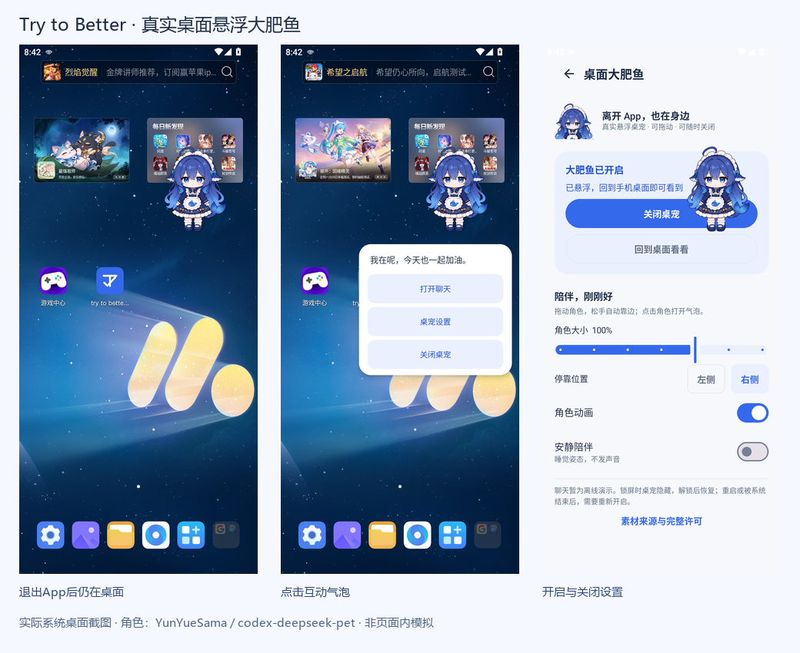

# 真实系统悬浮窗 · 实际截图

0.2.21 / code23，专用Android12/API32模拟器。普通手机配置1080×2400、440dpi，另切换1080×2160测试可用显示区域适配。测试修改的是专用模拟器显示尺寸，不代表实体设备传感器旋转或横屏验收。

桌面截图实际位于 `app.lawnchair/.LawnchairLauncher`，同时存在Try to Better的 `TYPE_APPLICATION_OVERLAY` 小窗口；不是预览页中的模拟桌面。桌面壁纸、广告组件与系统图标来自模拟器Launcher，不是Try to Better的角色素材或设计内容。测试只启动独立桌宠设置Activity，没有加载业务Repository或真实日程。

角色作者：YunYueSama，来源：[codex-deepseek-pet](https://github.com/YunYueSama/codex-deepseek-pet)。沿用完整透明图集，未重绘角色；署名、完整许可、处理记录与授权边界见[素材说明](ANDROID_PET_DESIGN_V1.md#素材与授权)。

| 截图 | 内容 |
| --- | --- |
| [00 系统授权](screenshots/overlay/00-permission.png) | 真实系统“显示在其他应用上层”页面 |
| [01 开启与设置](screenshots/overlay/01-settings.png) | 实际服务状态、大小、位置及开关 |
| [02 桌面常驻](screenshots/overlay/02-desktop.png) | 返回Launcher后，完整透明角色仍显示 |
| [03 点击气泡](screenshots/overlay/03-bubble.png) | 原有挥手逐帧动作和三个实际入口 |
| [04 离线聊天](screenshots/overlay/04-chat.png) | 气泡打开App内的轻量聊天；明确为模拟回复 |
| [05 左侧停靠](screenshots/overlay/05-left.png) | 实际拖动后吸边 |
| [06 小尺寸睡觉](screenshots/overlay/06-small-sleep.png) | 112dp角色与安静陪伴姿态 |
| [07 关闭后](screenshots/overlay/07-closed.png) | 桌面角色和前台通知均已移除 |
| [08 区域变化](screenshots/overlay/08-resized-area.png) | 系统切换至1080×2160后，角色仍在可用区域 |
| [09 常驻通知](screenshots/overlay/09-notification.png) | 通知提供设置和关闭动作；测试触发其关闭PendingIntent并验证清理 |

总览仅等比排列原始截图，未重绘或替换界面内容。实际手机的授权、触感、后台留存、输入法及耗电仍需分别体验。
