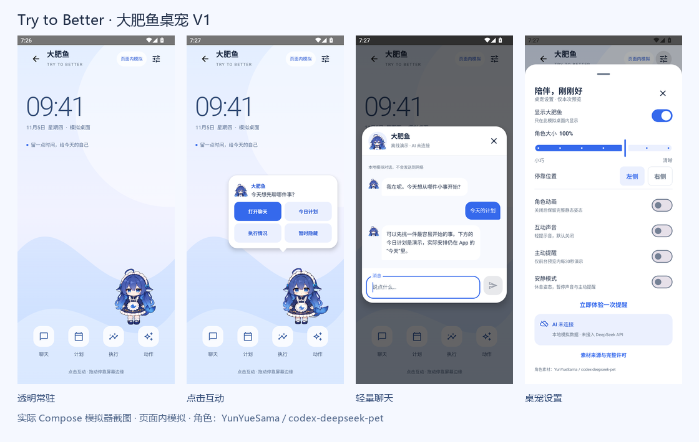

# 大肥鱼 V1 手机尺寸截图

以下是最终0.2.20预览源码在专用、未加载业务Repository的Compose测试宿主中实际运行并截图的界面，不是设计软件合成的UI。专用模拟器Android 12 / API32，1080×2400物理像素；分别使用440dpi（约393dp宽）与480dpi（360dp宽）。测试宿主强制竖屏。状态栏来自测试宿主；壁纸时间09:41为明确标注的模拟时钟。

普通静态截图关闭角色动画以稳定姿态；另一项运行检查实际开启走路动画、验证移动，再关闭动画验证停止。所有计划、执行和消息均为示例，不包含真实用户数据。模拟器截图不等于实体手机或系统悬浮窗验收。

素材作者：YunYueSama；[上游仓库](https://github.com/YunYueSama/codex-deepseek-pet)。截图中的角色复用原作，未重绘；等比缩小及重新排列图集，头像取现有立绘头肩。完整[许可](../../android/app/src/main/assets/petpreview/LICENSE)及[素材边界](../../android/app/src/main/assets/petpreview/ASSET_LICENSE.md)随源码和APK保留。

| 界面 | 393dp | 360dp |
| --- | --- | --- |
| 透明角色默认右侧停靠 | [完整截图](screenshots/393dp/01-desktop.png) | [完整截图](screenshots/360dp/01-desktop.png) |
| 点击展开轻气泡 | [完整截图](screenshots/393dp/02-bubble.png) | [完整截图](screenshots/360dp/02-bubble.png) |
| 拖动后左侧停靠 | [完整截图](screenshots/393dp/03-docked-left.png) | [完整截图](screenshots/360dp/03-docked-left.png) |
| 思考状态 | [完整截图](screenshots/393dp/04-thinking.png) | [完整截图](screenshots/360dp/04-thinking.png) |
| 聊天及本地回复 | [完整截图](screenshots/393dp/05-chat.png) | [完整截图](screenshots/360dp/05-chat.png) |
| 设置窗口 | [完整截图](screenshots/393dp/06-settings.png) | [完整截图](screenshots/360dp/06-settings.png) |
| 最小角色112dp | [完整截图](screenshots/393dp/07-small.png) | [完整截图](screenshots/360dp/07-small.png) |
| 安静模式休息姿态 | [完整截图](screenshots/393dp/08-quiet.png) | [完整截图](screenshots/360dp/08-quiet.png) |
| 顶部停靠，气泡自动出现在下方 | [完整截图](screenshots/393dp/09-top-dock.png) | [完整截图](screenshots/360dp/09-top-dock.png) |

总览图仅将4张393dp原始截图等比排列，未改变界面内容。全部细节以各张原始截图为准。
